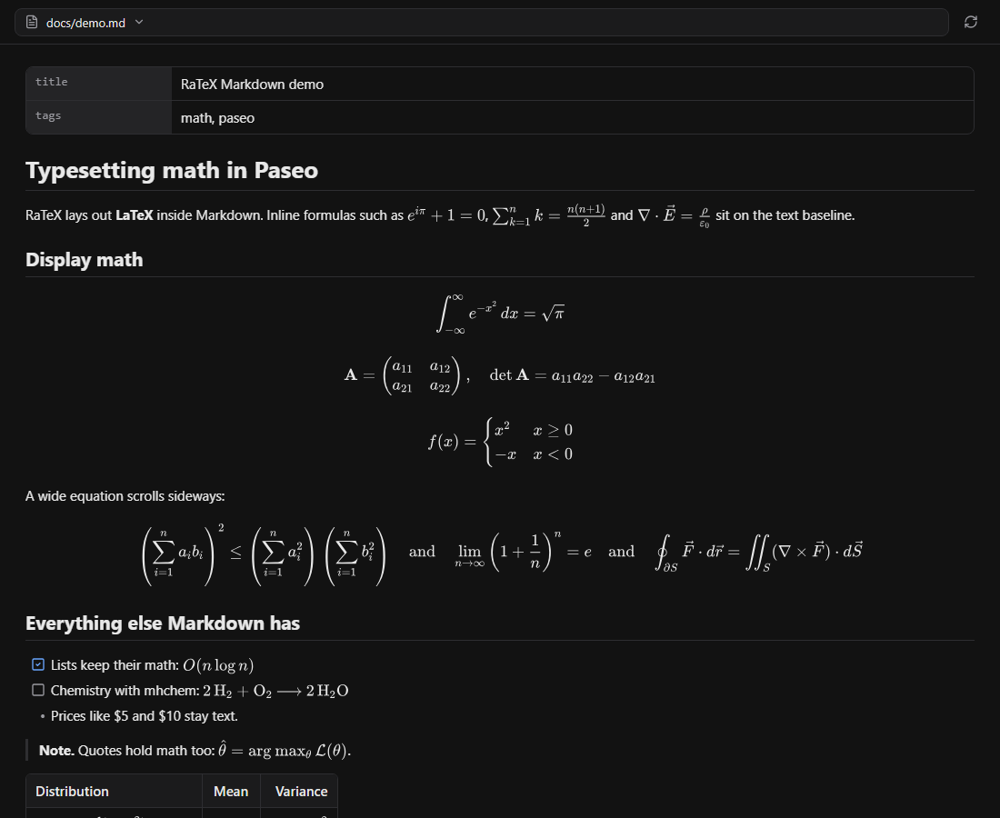
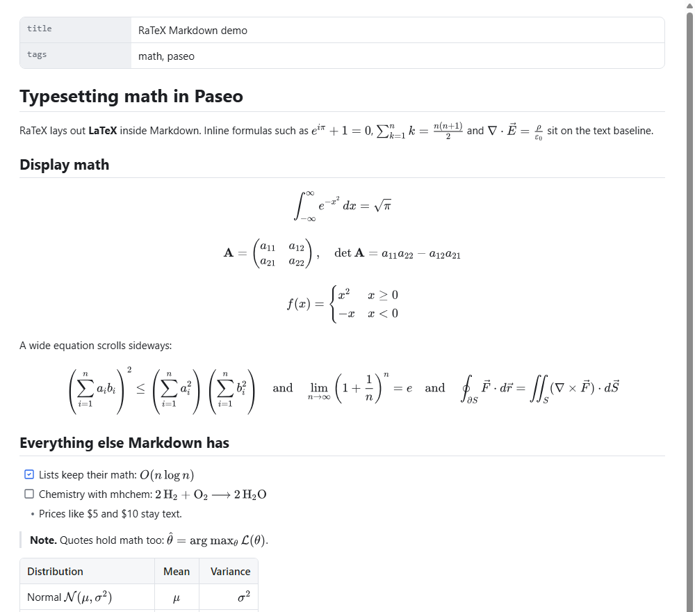
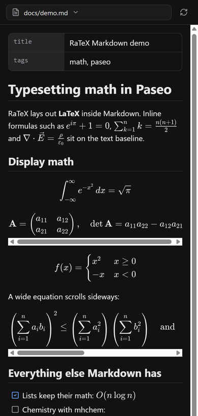

# RaTeX Markdown for Paseo

Open Markdown files in [Paseo](https://paseo.sh) with their LaTeX math typeset by
[RaTeX](https://github.com/erweixin/RaTeX), a KaTeX-compatible math engine written in Rust.



## Features

- Inline math with `$…$`, `\(…\)` and GitHub's `` $`…`$ ``; display math with `$$…$$`, `\[…\]`
  and ```` ```math ```` fences. Prices such as `$5 and $10` stay text.
- Everything RaTeX supports: KaTeX math syntax, environments (`aligned`, `cases`, matrices),
  chemistry with `\ce` and `\pu`, and `\color`.
- The rest of the document renders too: headings, emphasis, links, lists and task lists,
  quotes, tables with alignment, code blocks, footnotes, YAML front matter and images.
- Formulas are vector images drawn from the KaTeX fonts, so they stay sharp at any zoom and
  follow the Paseo theme. Wide equations scroll sideways instead of shrinking.
- Selecting text across a formula copies its TeX source.
- Edits on disk show up while the document is open.
- An invalid formula shows its source and RaTeX's error instead of breaking the page.

| Light theme, as a file panel | Phone width |
| --- | --- |
|  |  |

## How it opens Markdown

Paseo's plugin API decides where the plugin can draw:

- **Paseo 0.13 and later** ([file panels](https://github.com/getpaseo/paseo/pull/7411), merged
  after 0.12.0): opening a
  `.md` or `.markdown` file offers **Markdown (RaTeX)** next to Paseo's own Markdown and Source
  panels. Pick it and check **Don't ask me again** to make it the default for Markdown files.
- **Paseo 0.11 and 0.12**: press <kbd>⌘K</kbd> / <kbd>Ctrl+K</kbd> in a workspace and run
  **Open Markdown preview (RaTeX)**. The panel lists the workspace's Markdown files; pick one to
  read it. Relative links to other Markdown files open in the same panel.

The plugin detects file panel support at runtime, so the same release works on both.

## Requirements

| Component | Requirement |
| --- | --- |
| Paseo | 0.11.0 or later, daemon and app |
| Daemon host | Node.js and npm on the daemon's `PATH`, for npm or Git installation |
| Clients | Desktop and web render formulas. iOS and Android render them on hosts whose `Icon` draws inline SVG (Paseo 0.13 and later) and show the TeX source on older ones. |

Plugins must be enabled on the daemon under **Settings → Plugins → Enable plugins**. Plugins
are trusted code: the server half runs on the daemon host and the client half inside Paseo.

## Install

From npm:

```bash
paseo plugin install npm:paseo-ratex-markdown
paseo plugin ls
```

From GitHub (the daemon runs `npm ci` and generates the embedded assets during installation):

```bash
paseo plugin add git:ZedRover/paseo-ratex-markdown
```

You can also paste either source into **Settings → Plugins → Plugin source**. The plugin ID,
the npm package and the repository share one name: update with
`paseo plugin update paseo-ratex-markdown`.

## Math syntax

| Written as | Renders as |
| --- | --- |
| `$x^2$`, `\(x^2\)`, `` $`x^2`$ `` | inline math |
| `$$ … $$` and `\[ … \]` on their own lines | display math |
| `$$x^2$$` inside a paragraph | display math between the paragraph's halves, as on GitHub |
| ```` ```math ```` fenced block | display math |

Rules that keep prose intact:

- An inline `$` must not be followed by a space, the closing `$` must not follow a space or
  precede a digit, and a `$` that starts a word ends the attempt. `$5 and $10` is text.
  Inline math may wrap onto the next line, as formatters such as Prettier wrap prose.
- `\$` is a literal dollar sign, and `\[1\]` inside a sentence is an escaped bracket, as in
  CommonMark. Code spans and code blocks are never math.
- Display math cannot cross a blank line, so a stray `$$` does not swallow the document.
- Formulas longer than 4096 characters are shown as source.

## How it works

```text
Markdown text ──► markdown-it + math rules (client) ──► document tree
                                                          │ formulas, batched
                                                          ▼
                         daemon: RaTeX WASM lays out each formula (DisplayList)
                                 opentype.js reads KaTeX glyph outlines
                                                          │ scene: glyphs, rules, paths
                                                          ▼
   web/desktop: one SVG  per formula    iOS/Android: one inline SVG icon per glyph
```

The daemon half embeds the `ratex-wasm` binary and the KaTeX fonts, so nothing is fetched at
runtime. Its SVG output matches RaTeX's own `ratex-svg` renderer pixel for pixel on the test
formulas. Layouts are cached on both sides, so a theme change repaints without new requests,
and an edit only lays out the formulas that changed.

## Privacy and data access

- The daemon reads only Markdown files (`.md`, `.markdown`) and images inside the workspace
  directory that Paseo reports for the open workspace, after resolving symlinks. Paths that
  leave the workspace are refused.
- Formulas are laid out on the daemon; nothing is sent to other services.
- Images with `http(s)` addresses load directly on the client, as in any Markdown viewer.
- Links open in the system browser only for `http`, `https` and `mailto`.
- Raw HTML is never interpreted. HTML blocks show as source; inline formatting tags such as
  `<kbd>` or `<sup>` are dropped and their text kept, `<br>` breaks the line, `` shows its
  label, and any other tag shows as written.

## Limitations

- Code blocks are not syntax highlighted, and Mermaid diagrams show as code.
- Inline images inside links or text (such as badges) show as their label; standalone images
  render as blocks.
- Characters outside the KaTeX fonts, such as CJK inside `\text{}`, are drawn with the
  client's system fonts.
- Paseo 0.12 and earlier have no file panels, so there documents open in the plugin's own
  panel instead of the file tab.

## Development

```bash
npm ci            # installs dependencies and embeds the RaTeX assets (npm run prepare)
npm run typecheck
npm test
paseo plugin install "$PWD"   # try it on your local daemon
paseo plugin reload paseo-ratex-markdown
```

`npm run test:browser` renders the plugin in Chrome with react-native-web, the way Paseo
evaluates client bundles. Install the browser tools outside the plugin and point at them:

```bash
npm install --prefix /tmp/ratex-browser esbuild puppeteer-core react@19.1.0 react-dom@19.1.0 react-native-web@0.21 @tanstack/react-query zod lucide-static
RATEX_BROWSER_DEPS=/tmp/ratex-browser CHROME_BIN=/usr/bin/google-chrome npm run test:browser
```

Set `CHROME_CDP_URL` instead of `CHROME_BIN` to use a running Chrome, `RATEX_SCREENSHOTS=dir`
to save screenshots, and `RATEX_CLIENT_BUNDLE=file` to test a bundle taken from a daemon's
plugin catalog.

`npm run check:package` checks the files `npm pack` would publish.

## Credits

- [RaTeX](https://github.com/erweixin/RaTeX) by erweixin, MIT: parsing and layout (`ratex-wasm`).
- [KaTeX fonts](https://github.com/KaTeX/KaTeX), SIL Open Font License 1.1, shipped in `ratex-wasm`.
- [markdown-it](https://github.com/markdown-it/markdown-it) and
  [markdown-it-footnote](https://github.com/markdown-it/markdown-it-footnote), MIT.
- [opentype.js](https://github.com/opentypejs/opentype.js), MIT.

## License

[MIT](LICENSE)
